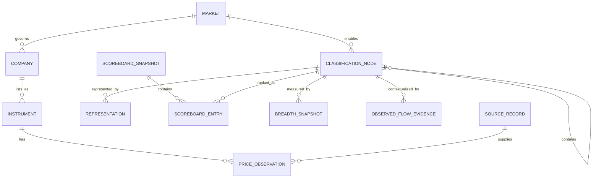

# Data Model: Market Leadership Screener

## Modeling Rules

- Identifiers are stable strings; display names and symbols are not identifiers.
- Dates are ISO calendar dates. `as_of` is the observation date; `available_on` is the first date the
  application may use the observation.
- Historical classification, proxy, and source relationships are effective-dated.
- Expected missing evidence produces `INSUFFICIENT` plus reason codes, never a guessed value.
- Company and instrument remain separate so one company may have multiple listings.

## Reference Entities

### Market

`market_id`, `name`, `base_currency`, `timezone`, `calendar_id`, `local_benchmark_id`,
`classification_scheme_id`, `enabled_from`, `enabled_to`.

Validation: one active local benchmark and one documented sector/industry scheme; currency is ISO
4217; the primary listing market governs a multi-listed company. US/JP/GB reference markets in
`tests/fixtures/acceptance/market_data.json` are controlled acceptance inputs, not live coverage.

### ClassificationNode

`node_id`, `scheme_id`, `level` (`SECTOR`, `INDUSTRY_GROUP`, `INDUSTRY`, `SUB_INDUSTRY`), `name`,
`parent_node_id`, `effective_from`, `effective_to`.

Validation: sector-to-industry ancestry is effective-dated and acyclic; an intermediary
`INDUSTRY_GROUP` is retained where the scheme uses it. Never apply today's membership to history.

### Company and Instrument

Company: `company_id`, `name`, `primary_market_id`, effective-dated `classification_path`.

Instrument: `instrument_id`, `company_id?`, `asset_category` (`EQUITY` in this release), `kind`
(`STOCK`, `FUND`, `INDEX`), `symbol`, `exchange`, `currency`, `return_basis`, `name`, `isin?`,
`active_from`, `active_to`.

Validation: symbol is unique per exchange and effective period; stocks reference one company; funds
and indices do not impersonate companies. A future category is dispatched to its separately specified
model before equity calculations and cannot enter with `asset_category = EQUITY`.

### Benchmark and Representation

Benchmark: `benchmark_id`, `instrument_id`, `scope` (`LOCAL`, `GLOBAL`), `market_id?`, `currency`,
`return_basis`.

Representation: `proxy_id`, `market_id`, `node_id`, `proxy_type` (`FUND`, `INDEX`,
`EQUAL_WEIGHT_BASKET`, `NONE`), `instrument_id?`, `member_ids`, `purity_pct?`, `aum_usd?`,
`adv20_usd?`, `selected_as_of`, `effective_from`, `effective_to`, `qualification_reasons`.

Validation: document each fund, official index, or constituent basket's composition basis, effective
dates, source and qualification. A representation unavailable for required history makes its
classification price result insufficient; no unverified liquidity or purity threshold is implied.

## Observation Entities

### PriceObservation and FxObservation

Price: `instrument_id`, `date`, official-session OHLC, `volume`, `adjusted_close`, `return_basis`,
`source_id`, `available_on`.

FX: `base_currency`, `quote_currency`, `date`, `close`, `source_id`, `available_on`.

Validation: one value per key and source version; global conversion uses same-close FX. A missing FX
observation blocks only the global result.

### FundHolding and Optional LiquidityObservation

Liquidity (only where qualified as a documented representation property): `instrument_id`,
`as_of`, `adv20_usd`, `aum_usd?`, `source_id`, `available_on`.

Holding: `fund_instrument_id`, `held_instrument_id`, `weight_pct`, `as_of`, `source_id`,
`available_on`.

Validation: weights are non-negative, effective-dated, source-attributed, and reconcile to the
documented coverage. Phase 2 has no live holdings or liquidity input; approve any additional
qualification thresholds and source rights before deploying a live representation adapter.

### ObservedFlowEvidence

`flow_id`, `fund_instrument_id`, `represented_node_id`, `event_period_start`, `event_period_end`,
`available_on`, `net_flow`, `flow_currency`, `assets`, `assets_as_of`, `flow_pct_assets?`,
`coverage`, `overlap_group?`, `source_id`, `freshness`, `reason_codes`.

Validation: `flow_pct_assets = 100 * net_flow / assets` only with positive, temporally compatible
assets; otherwise normalization is insufficient. Availability cannot precede the event period.
Overlapping funds are not summed without a documented deduplication and coverage rule. Missing,
partial or stale flows leave the price ranking untouched. Changes in assets, price and volume are
never substitutes for observed net flow.

### SourceRecord

`source_id`, `name`, `dataset`, `license_label`, `retrieved_at`, `version`, `checksum`.

Every observation and displayed outcome resolves to at least one source record or an explicit
`SOURCE_UNAVAILABLE` reason.

## Calculated Entities

### MarketRegime

`market_id`, `benchmark_id`, `as_of`, `close`, `sma150`, `normalized_slope_pct`,
`slope_state`, `regime`, `data_quality`, `reason_codes`, `source_ids`.

States: slope is `RISING`, `FLAT`, `FALLING`, or `UNDEFINED`; regime is `BULLISH`, `SIDEWAYS`,
`BEARISH`, or `INSUFFICIENT`. Greater than +0.025% normalized OLS slope over 20 latest 150-session
average values is rising; less than -0.025% is falling; equality is flat. Undefined slope or missing
current close/average makes regime `INSUFFICIENT` rather than implying sideways.

### ScoreboardSnapshot and ScoreboardEntry

Snapshot: `snapshot_id`, `market_id`, `level`, `as_of`, `benchmark_id`, `currency_basis`,
`return_basis`, `entry_ids`, `built_at`, `ruleset_version`, `source_ids`. The `as_of` is the latest
completed week for that market; do not combine differently dated local weeks into a pooled ranking.

Entry: `entry_id`, snapshot and node IDs, representation ID and type, absolute and local-relative
1-week/1-month/3-month/6-month/12-month returns, parent-sector-relative industry returns,
3/6/12-month strengths, composite, 50-session composite average, prior-week composite,
week-over-week change, prior rank, rank change, rank, status, momentum state, data sufficiency,
warning/reason codes, and provenance IDs.

Validation: components use the latest shared eligible observation, matching return basis and local
benchmark. Composite = `0.4*RS_3m + 0.3*RS_6m + 0.3*RS_12m`; status requires 50-session composite
history, and only sufficient entries rank. Ties use six-month, three-month, twelve-month, then name.
An industry belongs to its dated parent sector and is ranked within that market and hierarchy.

### BreadthSnapshot, ConcentrationEvidence, TradingActivityEvidence

Breadth: `node_id`, `as_of`, `membership_as_of`, `above_sma50_pct?`,
`above_sma200_pct?`, `included_count`, `eligible_count`, `coverage_pct`, `reason_codes`,
`source_ids`. Show each percentage only with at least five eligible members and history for at
least 80% of them; missing evidence affects only breadth.

Concentration: `node_id`, `as_of`, `cap_weighted_return?`, `equal_weight_return?`,
`comparison_basis`, `weight_coverage`, `source_ids`, `reason_codes`. Material disagreement is
labelled possible concentration under a documented, versioned threshold, never broad participation
by assumption.

Trading activity: `node_id`, `as_of`, `indicator`, `value?`, `comparison_period`, `coverage`,
`source_ids`, `reason_codes`. Every indicator is explicitly **inferred trading activity** and is
insufficient without aligned close/volume history. No indicator is an observed fund flow.

## UI State

`FilterState` is session-local and contains selected market IDs, hierarchy level, leadership statuses,
momentum states, proxy types, sufficiency states, sort field/direction, and selected sector. It is
not persisted in a shared cache or snapshot. Clearing filters preserves selected markets and
restores the latest completed weekly SECTOR scoreboard.

## Relationships

