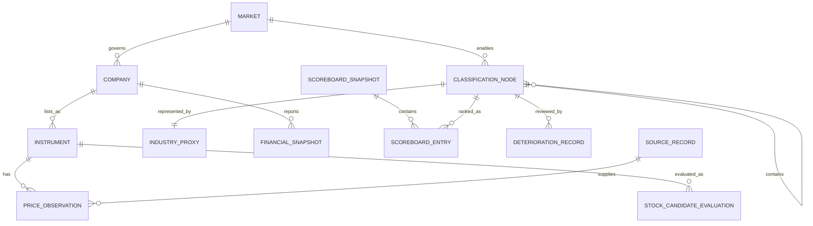

# Data Model: Market Leadership Screener

## Modeling Rules

- Identifiers are stable strings; display names and symbols are not identifiers.
- Dates are ISO calendar dates. `as_of` is the observation date; `available_on` is the first date the
  application may use the observation.
- Historical classification, proxy, and source relationships are effective-dated.
- Expected missing evidence produces `INSUFFICIENT` plus reason codes, never a guessed value.
- Company and instrument remain separate so one company may have multiple listings.

## Reference Entities

### Market

`market_id`, `name`, `base_currency`, `timezone`, `calendar_id`, `local_benchmark_id`,
`classification_scheme_id`, `enabled_from`, `enabled_to`.

Validation: one active local benchmark and one active GICS scheme; currency is ISO 4217; the primary
listing market governs a multi-listed company.

### ClassificationNode

`node_id`, `scheme_id`, `level` (`SECTOR`, `INDUSTRY_GROUP`, `INDUSTRY`, `SUB_INDUSTRY`), `name`,
`parent_node_id`, `effective_from`, `effective_to`.

Validation: parent is exactly one level higher; each effective GICS chain is complete and acyclic.

### Company and Instrument

Company: `company_id`, `name`, `primary_market_id`, effective-dated `classification_path`.

Instrument: `instrument_id`, `company_id?`, `asset_category` (`EQUITY` in this release), `kind`
(`STOCK`, `FUND`, `INDEX`), `symbol`, `exchange`, `currency`, `return_basis`, `name`, `isin?`,
`active_from`, `active_to`.

Validation: symbol is unique per exchange and effective period; stocks reference one company; funds
and indices do not impersonate companies. A future category is dispatched to its separately specified
model before equity calculations and cannot enter with `asset_category = EQUITY`.

### Benchmark and IndustryProxy

Benchmark: `benchmark_id`, `instrument_id`, `scope` (`LOCAL`, `GLOBAL`), `market_id?`, `currency`,
`return_basis`.

IndustryProxy: `proxy_id`, `market_id`, `node_id`, `proxy_type` (`FUND`, `INDEX`,
`EQUAL_WEIGHT_BASKET`, `NONE`), `instrument_id?`, `member_ids`, `purity_pct?`, `aum_usd?`,
`adv20_usd?`, `selected_as_of`, `effective_from`, `effective_to`, `qualification_reasons`.

Validation: choose the most liquid qualifying fund first, then an official index, then at least five
equal-weight eligible stocks. `NONE` is explicit and makes the node insufficient.

## Observation Entities

### PriceObservation and FxObservation

Price: `instrument_id`, `date`, official-session OHLC, `volume`, `adjusted_close`, `return_basis`,
`source_id`, `available_on`.

FX: `base_currency`, `quote_currency`, `date`, `close`, `source_id`, `available_on`.

Validation: one value per key and source version; global conversion uses same-close FX. A missing FX
observation blocks only the global result.

### LiquidityObservation and FundHolding

Liquidity: `instrument_id`, `as_of`, `adv20_usd`, `aum_usd?`, `source_id`, `available_on`.

Holding: `fund_instrument_id`, `held_instrument_id`, `weight_pct`, `as_of`, `source_id`,
`available_on`.

Validation: fund weights are non-negative and approximately sum to 100%; stock floor is $5 million
ADV; fund floors are $100 million AUM and $2 million ADV; fund purity is at least 60%.

### FinancialSnapshot and SurvivalCheck

FinancialSnapshot includes `company_id`, `fiscal_period_end`, currency, cash and equivalents,
operating cash flow, capital expenditure, interest expense TTM, EBIT TTM, market cap USD, shares,
source, and `available_on`.

SurvivalCheck includes `company_id`, `evaluated_as_of`, `source_period`, `result` (`PASS`, `FAIL`,
`INSUFFICIENT`), quarterly cash burn, runway years, interest cover TTM, market-cap tier,
interest-cover threshold, volatility class, proxy-basis flag, financial-company exemption, and reasons.

Validation: `quarterly_cash_burn = max(0, capital_expenditure - operating_cash_flow)` for the latest
reported quarter after excluding non-cash accounting items. Zero burn produces unlimited runway;
otherwise `runway_years = cash_and_equivalents / quarterly_cash_burn / 4`, using existing cash only,
and must be at least two years. A GAAP loss may be an explicitly flagged proxy only when no better
cash-flow evidence exists. Interest cover is EBIT TTM divided by interest expense TTM and
independently must meet the size-by-volatility minimum:

| Market-cap tier (USD) | Low | Medium | High | Extreme |
|-----------------------|-----|--------|------|---------|
| Mega/large, above $10B | 1.5 | 2 | 3 | 4 |
| Mid, $2B through $10B | 2 | 3 | 4 | 5 |
| Small/micro, below $2B | 3 | 4 | 5 | 6 |

Evidence older than two quarters is insufficient. Financial companies are exempt from the interest-
cover veto because regulatory-capital ratios are outside this feature; they still require the runway
test. PASS is never itself a reason to rank or buy a stock.

### EvidenceItem

`evidence_id`, `subject_type`, `subject_id`, `kind`, `direction`, `magnitude`, `event_date`,
`available_on`, `coverage`, `source_id`, `source_reference`, `lag_days`.

Validation: availability cannot precede the event. Evidence is contextual and cannot alter status,
rank, top group, or eligibility.

### SourceRecord

`source_id`, `name`, `dataset`, `license_label`, `retrieved_at`, `version`, `checksum`.

Every observation and displayed outcome resolves to at least one source record or an explicit
`SOURCE_UNAVAILABLE` reason.

## Calculated Entities

### MarketRegime

`market_id`, `view`, `benchmark_id`, `as_of`, `close`, `sma150`, `normalized_slope_pct`,
`slope_state`, `regime`, `data_quality`, `reason_codes`, `source_ids`.

States: slope is `RISING`, `FLAT`, `FALLING`, or `UNDEFINED`; regime is `BULLISH`, `SIDEWAYS`,
`BEARISH`, or `INSUFFICIENT`. Fewer than 20 average values makes slope `UNDEFINED` and regime
`SIDEWAYS` when the current close and average are present; missing either current value makes the
regime `INSUFFICIENT`.

### ScoreboardSnapshot and ScoreboardEntry

Snapshot: `snapshot_id`, `market_id`, `view`, `level`, `as_of`, `benchmark_id`, `currency_basis`,
`return_basis`, `entry_ids`, `built_at`, `ruleset_version`.

Entry: `entry_id`, snapshot and node IDs, proxy ID, 3/6/12-month strengths, composite, 50-session
composite average, prior-week composite, week-over-week change, rank, status, top-group flag,
eligibility, data quality, warning/reason codes, and provenance IDs.

Validation: all components share date, basis, and benchmark. Only sufficient entries rank. Ties use
six-month, three-month, twelve-month, then name. Top group size is `ceil(0.20 * ranked_count)`.

### DeteriorationRecord

`market_id`, `industry_node_id`, `review_date`, `consecutive_months_outside_top`, `active`,
`raised_at?`, `cleared_at?`, `reason` (`DECLINING`, `OUTSIDE_TOP_TWO_MONTHS`).

Transitions:

```text
CLEAR --monthly outside top--> COUNTING_1
COUNTING_1 --monthly outside top--> ACTIVE
COUNTING_1 --monthly back in top and not declining--> CLEAR
ACTIVE --monthly back in top and not declining--> CLEAR
ANY --weekly declining--> ACTIVE
```

An active state blocks new candidacy and creates review/reduce information, never a sell order.

### HoldingReviewFlag

`flag_id`, `holding_instrument_id`, `industry_node_id`, `review_date`, `deterioration_reason`,
`action` (`REVIEW_REDUCE`), `automatic_sale` (always false), `cleared_at?`.

The deterioration use case accepts the stable instrument IDs of existing holdings. At the next weekly
review it emits one flag for each held stock whose effective primary classification descends from the
declining industry. Monthly deterioration emits the same flag for affected holdings when the second
consecutive outside-top review activates it. An industry with no supplied holdings still retains its
deterioration record and new-candidacy block.

### StockCandidateEvaluation

`evaluation_id`, `stock_instrument_id`, `industry_node_id`, `as_of`, `industry_eligible`,
`rs_3m_vs_industry`, `rs_6m_vs_industry`, `survival_check_id`, `volatility_class`,
`primary_classification_matches`, `proxy_weight_pct`, `proxy_rank`, `research_reason_present`,
`research_reason`, `result` (`CANDIDATE`, `BLOCKED`, `INSUFFICIENT`), `gate_results`, `reason_codes`,
`source_ids`.

All required gates must pass. The written reason is retained for audit and display; blank or
whitespace-only text fails its gate. Insufficient required evidence is distinct from a definite failed
gate.

## UI State

`FilterState` is session-local and contains market, hierarchy level, statuses, top-group choice,
eligibility choices, proxy types, search text, sort field, sort direction, and selected node. It is
not persisted in a shared cache or snapshot. Clearing it restores the weekly industry scoreboard.

## Relationships

